# Intelligent Image Denoising: Classical Spatial Filters vs. Convolutional Autoencoder vs. Novel Fourier KAN Autoencoder

<p align="center">
  <b><a href="README.md">🇬🇧 English</a></b> • <b><a href="README_UA.md">🇺🇦 Українська</a></b>
</p>

[](https://www.python.org/)
[](https://pytorch.org/)
[](https://developer.apple.com/metal/pytorch/)
[](https://github.com/liutianlin0121/BSD-432-68)
[](LICENSE)

Computer Vision Course Project (Topic 2: *Intelligent Image Denoising based on Autoencoders*).  
Author: **Bohdan Pinchuk**

---

## 📌 Project Overview & Motivation

Image restoration and denoising remain foundational challenges in low-level computer vision. Digital sensors inevitably introduce corruptions during acquisition under low-light conditions, high ISO, transmission degradation, and sensor heating.

The primary objective of this project is to conduct a systematic, end-to-end investigation across three fundamentally distinct denoising paradigms:
1. **Classical Spatial Filtering (Zero-Learning Baselines):** Gaussian filter (mandatory course baseline), Median filter, and Bilateral edge-preserving filter.
2. **Deep Learning Convolutional Baseline (CAE):** A 5-level symmetric Convolutional Autoencoder with reflection padding and skip connections, trained with a scale-balanced composite loss ($0.85 L_1 + 0.15 (1 - \text{SSIM})$).
3. **Novel Spectral Model (Fourier KAN Autoencoder):** A Kolmogorov-Arnold Network autoencoder employing learnable complex-exponential trigonometric Fourier harmonics along edges, stabilized via Sobolev spectral decay ($\sigma_k \propto 1/k^2$), learnable spatial phase shifts $\phi_k$, adaptive frequency scales $\omega_k$, and a residual SiLU highway.

All models undergo rigorous benchmarking on the standard **BSD68** dataset, evaluating restoration fidelity ($\text{PSNR}$, $\text{SSIM}$, $\text{MAE}$, $\text{MSE}$, $R^2$), inference latency, and parameter footprint, while noise robustness across 6 modalities is investigated in multi-modal experiments.

---

## 🔬 Methodological Pipeline (8 Stages)

```mermaid
flowchart LR
    S1["1. EDA & Data Audit<br/>(BSD432, BSD68, Stats)"] --> S2["2. Noise Engine<br/>(6 Modalities, 2D FFT)"]
    S2 --> S3["3. Classical Baselines<br/>(Gaussian, Median, Bilateral)"]
    S3 --> S4["4. Deep CAE Baseline<br/>(Conv Autoencoder, Optuna)"]
    S4 --> S5["5. Novel Fourier KAN<br/>(Spectral KAN, Sobolev Reg)"]
    S5 --> S6["6. Master Benchmark<br/>(PSNR, SSIM, Latency)"]
    S6 --> S7["7. Error Diagnostics<br/>(Inferno Residuals, RPSD)"]
    S7 --> S8["8. Synthesis & Decisions<br/>(Deployment Matrix)"]
```



1. **EDA & Data Ingestion:** Comprehensive analysis of BSD432 (training) and BSD68 (evaluation benchmark) datasets, dynamic range $[0, 255]$ verification, luminance profiling, and streaming train/val patch generation ($96 \times 96$).
2. **Multi-Modal Synthetic Noise Engine:** Procedural generation of 6 synthetic corruptions:
   - Additive White Gaussian Noise (AWGN, $\sigma \in [10, 50]$).
   - Impulse Salt & Pepper Noise ($p \in [0.02, 0.15]$).
   - Multiplicative Speckle Noise ($\text{Var} \in [0.04, 0.20]$).
   - Signal-dependent Poisson Noise ($\lambda \in [10, 50]$).
   - Periodic 2D Sinusoidal Striped Noise (simulating sensor grid interference).
   - Hybrid Composite Corruption (Gaussian + Impulse + Periodic).
3. **Classical Spatial Baselines:** Parameter grid tuning and evaluation for Gaussian blur, Median rank filter, and Bilateral range/spatial filter.
4. **Convolutional Autoencoder (CAE Baseline):** 5-stage CNN with Strided Convolutions / Transposed Convolutions, Reflection Padding, LeakyReLU/SiLU activations, and Optuna hyperparameter tuning.
5. **Novel Spectral Model (Fourier KAN Autoencoder):** Formulation of complex exponential 2D convolution layers with Fourier series basis expansion, Sobolev weight attenuation, and Bayesian optimization via Optuna.
6. **Master Multi-Model Benchmark:** Comparative evaluation matrix across all 5 models under identical hardware conditions (Apple Silicon MPS).
7. **Spatial & Spectral Error Diagnostics:** Local residual error heatmaps (`inferno` colormap) and 2D FFT Radial Power Spectral Density (RPSD) curves to quantify high-frequency texture preservation vs. noise attenuation.
8. **Engineering Synthesis & Deployment Matrix:** Multi-criteria decision trade-offs balancing visual fidelity, hardware latency, and memory footprint.

---

## 📊 Master Benchmark Results (BSD68 Dataset)

Summary of restoration performance evaluated across 68 full-resolution images from the benchmark test set:

| Model Architecture | Model Family | PSNR (dB) ↑ | SSIM ↑ | MSE ↓ | MAE ↓ | R² ↑ | Inference Latency ↓ | Parameters (M) ↓ | Storage Footprint ↓ |
|:---|:---|:---:|:---:|:---:|:---:|:---:|:---:|:---:|:---:|
| **Gaussian Filter** *(Baseline)* | Classical Spatial | 26.23 dB | 0.6815 | 365.62 | 11.52 | 0.8233 | **0.5 ms** (CPU) | **0.00 M** | **0.00 MB** |
| **Median Filter** | Classical Spatial | 25.51 dB | 0.7173 | 260.78 | 10.73 | 0.8842 | **0.5 ms** (CPU) | **0.00 M** | **0.00 MB** |
| **Bilateral Filter** | Classical Spatial | 25.49 dB | 0.6950 | 396.95 | 11.57 | 0.8099 | 1.3 ms (CPU) | **0.00 M** | **0.00 MB** |
| **Convolutional Autoencoder (CAE)** | Deep CNN Baseline | 28.09 dB | 0.8602 | 155.90 | 8.85 | 0.9274 | 13.1 ms (MPS) | 1.05 M | 4.01 MB |
| **Fourier KAN Autoencoder** | Novel Spectral Model | **29.91 dB** | **0.8749** | **138.44** | **7.83** | **0.9341** | 104.5 ms (MPS) | 7.78 M | 29.70 MB |

> [!NOTE]
> *Metrics represent evaluation across all 68 full-resolution benchmark images of BSD68 under 5 synthetic noise types (AWGN, Poisson, Speckle, Salt & Pepper, Periodic). Classical spatial filters run natively on multi-threaded CPU; deep learning models run on Apple Silicon MPS.*

---

## 💡 Key Findings & Engineering Insights

1. **Spectral Fidelity & Harmonic Functional Capacity:**
   - **Fourier KAN** achieves unequivocal leadership in structural reconstruction fidelity ($\text{PSNR} = \mathbf{29.91\text{ dB}}$, an improvement of **$+1.82\text{ dB}$** over CAE and **$+3.68\text{ dB}$** over Gaussian; $\text{SSIM} = \mathbf{0.8749}$, an improvement of **$+0.0147$** over CAE and **$+0.1934$** over Gaussian). Reconstruction error $\text{MSE} = 138.44$ (**$-11.2\%$** lower than CAE's $155.90$), $\text{MAE} = 7.83$ (**$-11.5\%$** lower than CAE's $8.85$), $R^2 = 0.9341$.
   - Bayesian hyperparameter optimization with Optuna (`TPESampler`) recorded a **$-23.67\%$** reduction in validation $\text{CompositeLoss}$ ($0.2205$ vs $0.2888$ for CAE), while the final training validation loss reached $0.05856$ (a **$-32.1\%$** reduction vs $0.0862$ for CAE). Leveraging $K=4$ harmonic orders and $64$ base channels ($7.78\text{ M}$ parameters, $29.70\text{ MB}$), the architecture completely eliminates Spectral Bias, preserving crisp contours without watercolor-like blurring. For constrained edge deployments, harmonic orders and channel width can be dynamically scaled ($K=2..3, C=24 \to \sim 0.9\text{M}$) for ultra-low memory footprints.
   - Learnable trigonometric kernels act as adaptive continuous harmonic interpolators along edges, eliminating the rigid discrete receptive field constraints of standard CNN kernels.

2. **Sobolev Regularization & High-Frequency Noise Memorization:**
   - Standard random initialization on Fourier harmonics causes rapid noise memorization and severe Gibbs ringing artifacts around sharp contours.
   - Enforcing Sobolev decay ($\sigma_k \propto 1/k^2$) constrains initial energy to low-frequency structural representations, ensuring smooth convergence and clean texture recovery.

3. **Trade-offs of Classical Spatial Filters & Latency:**
   - Classical filters require zero training data, zero parameter storage, and operate in $0.5$–$1.3\text{ ms}$ on CPU.
   - However, they exhibit fundamental physical limitations: Gaussian and Median filters blur true image edges indiscriminately, while Bilateral filtering struggles to suppress structured periodic or heavy Gaussian noise without oversmoothing fine gradients.
   - Deep models on Apple Silicon MPS demonstrate consistent real-time throughput: CAE delivers $13.1\text{ ms}$ ($\approx 76\text{ FPS}$, fully meeting 60+ FPS real-time video streaming needs), while Fourier KAN achieves $104.5\text{ ms}$ ($\approx 9.6\text{ FPS}$, serving as the premier choice for sub-second high-precision diagnostic and archival image enhancement).

4. **Spectral Power Distribution (2D FFT RPSD Analysis):**
   - Radial Power Spectral Density profiles demonstrate that Fourier KAN closely traces the natural scene power decay of clean ground-truth images ($P(f) \propto 1/f^2$), whereas standard CAE exhibits spectral attenuation in mid-to-high frequency bands (causing subtle watercolor-like blurring).

---

## 🗂️ Project Repository Structure

```
ComputerVision-PBY_HW16_Course_Project/
├── Bohdan_Pinchuk_CV_HW16.ipynb      # Master interactive research notebook (English)
├── Bohdan_Pinchuk_CV_HW16_UA.ipynb   # Master interactive research notebook (Ukrainian)
├── README.md                         # Project documentation and benchmark manifest (English)
├── README_UA.md                      # Project documentation and benchmark manifest (Ukrainian)
├── .gitignore                        # Git exclusion rules for large datasets and weights
├── apps/                             # Modular engineering architecture
│   ├── main.py                       # Device management, streaming datasets, augmentations, losses & metrics
│   ├── models.py                     # Implementations: CAE, Fourier KAN, composite SSIM+L1 loss
│   ├── spatial_filters.py            # Classical spatial baselines: Gaussian, Median, Bilateral
│   └── reporter.py                   # Structured tabular Pandas reporting utilities
└── resources/
    ├── data/                         # BSD (Berkeley Segmentation Dataset) image corpora
    │   ├── BSD432/                   # 432 monochrome training images
    │   ├── CBSD432/                  # 432 color RGB training images
    │   ├── BSD68/                    # 68 monochrome evaluation benchmark images
    │   └── CBSD68/                   # 68 color RGB evaluation benchmark images
    ├── models/                       # Checkpoints, parameter manifests, and Optuna studies
        ├── model_gaussian.json       # Optimal Gaussian filter kernel & sigma
        ├── model_median.json         # Optimal Median filter kernel size
        ├── model_bilateral.json      # Optimal Bilateral filter spatial & range sigmas
        ├── model_cae.pth             # Trained PyTorch weights for Convolutional Autoencoder (1.05M)
        ├── model_cae_params.json     # Best Optuna hyperparameters for CAE baseline
        ├── model_fourier_kan.pth     # Trained PyTorch weights for Fourier KAN Autoencoder (7.78M)
        └── model_fourier_kan_params.json # Best Optuna hyperparameters for Fourier KAN model
    └── reports/                      # Visual benchmarks and performance plots across 5 noise modalities
```

---

## 📚 Scientific Foundations & Literature References

This project builds upon peer-reviewed literature and open-source research implementations:

### Academic Papers:
* **Liu, Z., Wang, Y., Vaidya, S., Ruehle, F., Halverson, J., Soljačić, M., Hou, T. Y., & Tegmark, M.** (2024). *KAN: Kolmogorov-Arnold Networks*. MIT, Harvard, & Caltech. [arXiv:2404.19756](https://arxiv.org/abs/2404.19756).
* **Bodner, A., Tepsich, A., Brandstetter, J., & Vergari, A.** (2024). *Convolutional Kolmogorov-Arnold Networks*. [arXiv:2406.13155](https://arxiv.org/abs/2406.13155).
* **Mehrabian, A., et al.** (2024). *FourierKAN: Fourier Kolmogorov-Arnold Networks*. University of British Columbia. [arXiv:2409.09323](https://arxiv.org/abs/2409.09323).
* **Xu, J., Chen, Z., et al.** (2024). *Fourier KAN-Based Framework for Image Restoration*. University of Hong Kong. [arXiv:2406.01034](https://arxiv.org/abs/2406.01034).
* **Drokin, I.** (2024). *Torch-Conv-KAN: PyTorch Implementation of Convolutional KAN*. [arXiv:2407.01092](https://arxiv.org/abs/2407.01092).
* **Tancik, M., Srinivasan, P., Mildenhall, B., et al.** (2020). *Fourier Features Let Networks Learn High Frequency Functions in Low Dimensional Domains*. NeurIPS 2020. [arXiv:2006.10739](https://arxiv.org/abs/2006.10739).
* **Mao, X.-J., Shen, C., & Yang, Y.-B.** (2016). *Image Restoration Using Very Deep Convolutional Encoder-Decoder Networks with Symmetric Skip Connections*. Advances in Neural Information Processing Systems (NeurIPS 2016). [arXiv:1603.09056](https://arxiv.org/abs/1603.09056).
* **Tomasi, C., & Manduchi, R.** (1998). *Bilateral Filtering for Gray and Color Images*. In Proceedings of the Sixth International Conference on Computer Vision (IEEE ICCV 1998), pp. 839–846.

### Open-Source Reference Repositories:
* [`GistNoesis/FourierKAN`](https://github.com/GistNoesis/FourierKAN) — Original PyTorch implementation of 1D Fourier KAN layers.
* [`AntonioTepsich/Convolutional-KANs`](https://github.com/AntonioTepsich/Convolutional-KANs) — 2D Convolutional KAN foundational implementations.
* [`IvanDrokin/torch-conv-kan`](https://github.com/IvanDrokin/torch-conv-kan) — Efficient tensorized 2D Convolutional KAN operators.
* [`Ali-Meh619/FKAN`](https://github.com/Ali-Meh619/FKAN) — Fourier Kolmogorov-Arnold Networks for PyTorch.

---

## 🚀 Quickstart & Reproduction

### 1. Environment Setup
Clone the repository and install dependencies within a virtual environment:
```bash
git clone https://github.com/your-username/ComputerVision-PBY_HW16_Course_Project.git
cd ComputerVision-PBY_HW16_Course_Project

python3 -m venv .venv
source .venv/bin/activate
pip install -r requirements.txt  # torch torchvision torchaudio optuna opencv-python matplotlib scipy pandas
```

### 2. Running the Research Notebooks
Launch Jupyter Lab or PyCharm (both English and Ukrainian notebooks are 100% synchronized):
```bash
# English version
jupyter lab Bohdan_Pinchuk_CV_HW16.ipynb

# Ukrainian version
jupyter lab Bohdan_Pinchuk_CV_HW16_UA.ipynb
```

Each stage is organized into `# Input data`, `# Solution`, and `# Report` sections with automatic cache detection (`load_model = True`). Pre-computed weights in `resources/models/` will load instantaneously; setting `load_model = False` triggers full retraining and Optuna hyperparameter tuning.

---

## ⚖️ License
This project is licensed under the MIT License — see the [LICENSE](LICENSE) file for details.
