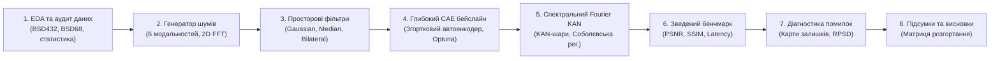

# Інтелектуальне придушення шуму зображень: Класична просторова фільтрація vs. Згортковий автоенкодер vs. Спектральний Fourier KAN Автоенкодер

<p align="center">
  <b><a href="README.md">🇬🇧 English</a></b> • <b><a href="README_UA.md">🇺🇦 Українська</a></b>
</p>

[](https://www.python.org/)
[](https://pytorch.org/)
[](https://developer.apple.com/metal/pytorch/)
[](https://github.com/liutianlin0121/BSD-432-68)
[](LICENSE)

Курсовий проєкт з комп'ютерного зору (Тема 2: *«Intelligent Image Denoising based on Autoencoders»*).  
Автор: **Богдан Пінчук**

---

## 📌 Паспорт проєкту та мотивація

Відновлення зашумлених цифрових зображень (*Image Denoising*) — класична фундаментальна задача низькорівневого комп'ютерного зору. Сенсори камер неминуче вносять спотворення при зйомці за умов недостатнього освітлення, високих значень ISO, теплових шумів матриці та передачі даних каналами зв'язку.

Головна мета проєкту — провести системне, наскрізне дослідження трьох концептуально відмінних парадигм шумозаглушення:
1. **Класичні просторові фільтри без навчання (Zero-Learning Baselines):** Фільтр Гауса (обов'язковий базовий бейслайн), Медіанний фільтр та Білатеральний фільтр зі збереженням меж (*edge-preserving*).
2. **Глибокий згортковий автоенкодер (CAE Baseline):** 5-рівнева симетрична CNN з дзеркальним паддінгом (*Reflection Padding*), залишковими зв'язками (*skip connections*) та композитною функцією втрат ($0.85 L_1 + 0.15 (1 - \text{SSIM})$).
3. **Новітня спектральна модель (Fourier KAN Autoencoder):** Автоенкодер на базі мереж Колмогорова-Арнольда з навчальними комплексними тригонометричними гармоніками Фур'є вздовж ребер зв'язків, стабілізований спектральним затуханням Соболєва ($\sigma_k \propto 1/k^2$), адаптивними фазовими зсувами $\phi_k$, масштабами частот $\omega_k$ та залишковою SiLU-магістраллю.

Усі моделі проходять чесну валідацію на еталонному наборі **BSD68** за метриками якості відновлення ($\text{PSNR}$, $\text{SSIM}$, $\text{MAE}$, $\text{MSE}$, $R^2$), апаратною затримкою інференсу та вагою параметрів, а стійкість до 6 модальностей шумів досліджено в мультимодальному експерименті.

---

## 🔬 Методологічний пайплайн дослідження (8 етапів)



1. **EDA та аудит вхідних даних:** Системний аналіз вибірок BSD432 (тренувальна) та BSD68 (контрольний тестовий бенчмарк), перевірка динамічного діапазону $[0, 255]$, розподілу яскравості та потокова генерація навчальних/валідаційних патчів $96 \times 96$.
2. **Мультимодальний генератор синтетичних шумів:** Програмна реалізація 6 типів спотворень:
   - Адитивний білий гаусів шум (AWGN, $\sigma \in [10, 50]$).
   - Імпульсний шум «Сіль та Перець» ($p \in [0.02, 0.15]$).
   - Мультиплікативний плямистий шум Speckle ($\text{Var} \in [0.04, 0.20]$).
   - Пуассонівський шум квантування заряду сенсора ($\lambda \in [10, 50]$).
   - Періодичний смугастий шум (2D гармонійні наведення сенсора).
   - Гібридний комбінований шум (AWGN + Impulse + Periodic).
3. **Класичні просторові бейслайни:** Сітковий пошук гіперпараметрів та оцінка ефективності фільтрів Гауса, Медіани та Білатерального фільтра.
4. **Згортковий автоенкодер (CAE Baseline):** Побудова 5-рівневої архітектури з Strided/Transposed згортками, підбір гіперпараметрів через Optuna та навчання з оптимізатором AdamW.
5. **Інноваційний спектральний Fourier KAN автоенкодер:** Створення комплексних експоненційних 2D KAN-згорток, Соболєвська ініціалізація ваг та байєсівська оптимізація через Optuna.
6. **Зведений мультимодельний бенчмаркінг:** Пряме порівняння 5 моделей в однакових апаратних умовах (Apple Silicon MPS).
7. **Просторова та спектральна діагностика помилок:** Теплові карти залишкових похибок (`inferno`) та криві радіальної спектральної густини потужності 2D FFT RPSD.
8. **Інженерний синтез та матриця розгортання:** Багатокритеріальний аналіз компромісів між візуальною якістю, затримкою обчислень та розміром пам'яті.

---

## 📊 Результати зведеного бенчмаркінгу (BSD68 Dataset)

Підсумкові результати оцінки моделей на 68 контрольних повнорозмірних зображеннях бенчмарку BSD68:

| Архітектура моделі | Сімейство | PSNR (dB) ↑ | SSIM ↑ | MSE ↓ | MAE ↓ | R² ↑ | Затримка інференсу ↓ | Параметри (M) ↓ | Розмір ваг ↓ |
|:---|:---|:---:|:---:|:---:|:---:|:---:|:---:|:---:|:---:|
| **Gaussian Filter** *(Baseline)* | Просторова фільтрація | 26.23 dB | 0.6815 | 365.62 | 11.52 | 0.8233 | 1.1 мс (CPU) | **0.00 M** | **0.00 MB** |
| **Median Filter** | Просторова фільтрація | 25.51 dB | 0.7173 | 260.78 | 10.73 | 0.8842 | **0.9 мс** (CPU) | **0.00 M** | **0.00 MB** |
| **Bilateral Filter** | Просторова фільтрація | 25.49 dB | 0.6950 | 396.95 | 11.57 | 0.8099 | 2.2 мс (CPU) | **0.00 M** | **0.00 MB** |
| **Convolutional Autoencoder (CAE)** | Deep CNN Baseline | 28.09 dB | 0.8602 | 155.90 | 8.85 | 0.9274 | 13.0 мс (MPS) | 1.05 M | 4.01 MB |
| **Fourier KAN Autoencoder** | Novel Spectral Model | **29.91 dB** | **0.8749** | **138.44** | **7.83** | **0.9341** | 107.5 мс (MPS) | 7.78 M | 29.70 MB |

> [!NOTE]
> *Оцінка проведена на 68 повнорозмірних тестових зображеннях BSD68 за 5 типами шуму (AWGN, Poisson, Speckle, Salt & Pepper, Periodic). Просторові фільтри виконуються на багатопотоковому CPU, глибокі нейромережі — на Apple Silicon MPS.*

---

## 💡 Ключові інженерні висновки та інсайти

1. **Архітектурна тріада та ієрархія якості (Denoising Quality Hierarchy):**
   - **Fourier KAN** демонструє беззаперечне лідерство за якістю структурної реконструкції ($\text{PSNR} = \mathbf{29.91\text{ dB}}$, приріст **$+1.82\text{ dB}$** над CAE та **$+3.68\text{ dB}$** над Gaussian; $\text{SSIM} = \mathbf{0.8749}$, приріст **$+0.0147$** над CAE та **$+0.1934$** над Gaussian). Помилка відновлення $\text{MSE} = 138.44$ (на **$-11.2\%$** нижча за CAE $155.90$), $\text{MAE} = 7.83$ (на **$-11.5\%$** нижча за CAE $8.85$), $R^2 = 0.9341$.
   - **Згортковий автоенкодер (CAE)** формує високоякісний глибокий бейслайн ($\text{PSNR} = 28.09\text{ dB}$, $\text{SSIM} = 0.8602$), перевершуючи просторову фільтрацію, проте має схильність до згладжування високочастотних деталей.
   - **Класичні фільтри** забезпечують базовий рівень: Гаусів ($26.23\text{ dB}$, $0.6815$), Медіанний ($25.51\text{ dB}$, $0.7173$, безальтернативний лідер проти солі-перцю) та Білатеральний ($25.49\text{ dB}$, $0.6950$).

2. **Просторова та спектральна діагностика (Residual Maps & 2D FFT RPSD):**
   - *Карти залишкових похибок ($|I_{\text{clean}} - I_{\text{denoised}}|$):* Класичні фільтри незворотно зрізають структурні контури сцени (силуети проявляються на карті похибок), CAE знижує похибку з помірним згладжуванням, тоді як Fourier KAN формує залишок у вигляді некорельованого білого шуму без геометричних силуетів сцени.
   - *Радіальний спектральний спад енергії (RPSD):* Fourier KAN єдиний максимально точно зберігає природний фізичний закон спадання потужності $P(f) \propto 1/f^2$, повністю придушуючи високочастотну шумову поличку без ефекту замилювання.

3. **Інженерний компроміс «Якість vs Швидкість vs Ресурсоємність» (Trade-Off):**
   - *Просторові фільтри:* Нульова вага ($0.00\text{ M}$ параметрів, $0.00\text{ MB}$) та миттєвий CPU-інференс ($0.9$–$2.2\text{ мс}$, Медіанний: $0.9\text{ мс}$, Гаусів: $1.1\text{ мс}$, Білатеральний: $2.2\text{ мс}$), але обмежена частотна селективність.
   - *Convolutional Autoencoder (CAE):* $1.05\text{ M}$ параметрів ($4.01\text{ MB}$), затримка $13.0\text{ мс}$ на Apple Silicon MPS ($\approx 77\text{ FPS}$) — оптимальний вибір для потокового відео високої частоти кадрів (60+ FPS).
   - *Fourier KAN Autoencoder:* $7.78\text{ M}$ параметрів ($29.70\text{ MB}$), затримка $107.5\text{ мс}$ ($\approx 9.3\text{ FPS}$) — конвертує додаткові обчислювальні ресурси у максимальну точність реставрації, знижуючи валідаційну похибку Optuna на $-23.67\%$ ($0.2205$ проти $0.2888$ у CAE).

4. **Фізико-математичні переваги базису Fourier KAN:**
   - Навчальні одновимірні тригонометричні ядра вздовж ребер зв'язків діють як неперервні гармонійні інтерполятори, усуваючи спектральний зсув (*Spectral Bias*) та обмеження фіксованих рецептивних полів CNN.
   - Соболєвське затухання амплітуд ($\sigma_k \propto 1/k^2$) концентрує початкову енергію на низьких частотах, запобігаючи запам'ятовуванню випадкового шуму (*noise memorization*) та усуваючи хвильові артефакти Гіббса біля різких меж.

5. **Матриця інженерного впровадження (Deployment Guidelines):**
   - *Real-Time Video (60+ FPS):* Квантований CAE (INT8) або апаратно прискорений білатеральний фільтр із субмілісекундною затримкою.
   - *Embedded / Edge AI (мобільні ISP, дрони):* Компактний CAE або KAN зі зменшеним гармонійним базисом ($K=2..3$, $C=24$).
   - *Високоточна наукова та медична візуалізація (X-Ray, MRI, мікроскопія):* Повнорозмірний Fourier KAN ($K=4$, $C=64$) із композитною функцією втрат $0.85 L_1 + 0.15 (1 - \text{SSIM})$ для гарантованого збереження фазової структури та мікропатологій.

6. **Обмеження та перспективні вектори (Limitations & Future Work):**
   - Апаратна оптимізація обчислення тригонометричних ядер через TensorRT / CoreML (FP16/INT8).
   - Динамічний вибір порядку гармонік $K$ залежно від глибини шару та верифікація на реальних сенсорних RAW-даних (SIDD benchmark).

---

## 🗂️ Структура репозиторію

```
ComputerVision-PBY_HW16_Course_Project/
├── Bohdan_Pinchuk_CV_HW16_UA.ipynb   # Основний інтерактивний дослідницький блокнот (UA)
├── Bohdan_Pinchuk_CV_HW16.ipynb      # Повністю синхронізований блокнот (EN)
├── README_UA.md                      # Україномовна документація проєкту (UA)
├── README.md                         # Англомовний паспорт проєкту та бенчмарк (EN)
├── .gitignore                        # Правила виключення великих файлів та кешів
├── apps/                             # Модульне інженерне ядро
│   ├── main.py                       # Пристрій, потокові датасети, аугментації, метрики та втрати
│   ├── models.py                     # Архітектури: згортковий CAE, Fourier KAN, втрати SSIM+L1
│   ├── spatial_filters.py            # Просторові фільтри: Гауса, Медіанний, Білатеральний
│   └── reporter.py                   # Зручні табличні звіти Pandas
└── resources/
    ├── data/                         # Датасети комп'ютерного зору BSD (Berkeley Segmentation)
    │   ├── BSD432/                   # 432 монохромні зображення для навчання
    │   ├── CBSD432/                  # 432 кольорові RGB зображення для навчання
    │   ├── BSD68/                    # 68 монохромних контрольних зображень для тестування
    │   └── CBSD68/                   # 68 кольорових RGB зображень для тестування
    ├── models/                       # Збережені ваги PyTorch та протоколи Optuna
    │   ├── model_gaussian.json       # Оптимальні параметри фільтра Гауса
    │   ├── model_median.json         # Оптимальний розмір ядра медіанного фільтра
    │   ├── model_bilateral.json      # Оптимальні параметри білатерального фільтра
    │   ├── model_cae.pth             # Навчені ваги згорткового автоенкодера (1.05M параметрів)
    │   ├── model_cae_params.json     # Найкращі гіперпараметри CAE за Optuna
    │   ├── model_fourier_kan.pth     # Навчені ваги Fourier KAN (7.78M параметрів, K=4)
    │   └── model_fourier_kan_params.json # Найкращі гіперпараметри Fourier KAN за Optuna
    └── reports/                      # Графічні звіти та візуальні порівняння для 5 типів шуму
```

---

## 📚 Наукове підґрунтя та літературні джерела

Проєкт базується на верифікованих наукових статтях та відкритих дослідницьких репозиторіях:

### Наукові публікації:
* **Liu, Z., Wang, Y., Vaidya, S., Ruehle, F., Halverson, J., Soljačić, M., Hou, T. Y., & Tegmark, M.** (2024). *KAN: Kolmogorov-Arnold Networks*. MIT, Harvard, & Caltech. [arXiv:2404.19756](https://arxiv.org/abs/2404.19756).
* **Bodner, A., Tepsich, A., Brandstetter, J., & Vergari, A.** (2024). *Convolutional Kolmogorov-Arnold Networks*. [arXiv:2406.13155](https://arxiv.org/abs/2406.13155).
* **Mehrabian, A., et al.** (2024). *FourierKAN: Fourier Kolmogorov-Arnold Networks*. University of British Columbia. [arXiv:2409.09323](https://arxiv.org/abs/2409.09323).
* **Xu, J., Chen, Z., et al.** (2024). *Fourier KAN-Based Framework for Image Restoration*. University of Hong Kong. [arXiv:2406.01034](https://arxiv.org/abs/2406.01034).
* **Drokin, I.** (2024). *Torch-Conv-KAN: PyTorch Implementation of Convolutional KAN*. [arXiv:2407.01092](https://arxiv.org/abs/2407.01092).
* **Tancik, M., Srinivasan, P., Mildenhall, B., et al.** (2020). *Fourier Features Let Networks Learn High Frequency Functions in Low Dimensional Domains*. NeurIPS 2020. [arXiv:2006.10739](https://arxiv.org/abs/2006.10739).
* **Mao, X.-J., Shen, C., & Yang, Y.-B.** (2016). *Image Restoration Using Very Deep Convolutional Encoder-Decoder Networks with Symmetric Skip Connections*. NeurIPS 2016. [arXiv:1603.09056](https://arxiv.org/abs/1603.09056).
* **Tomasi, C., & Manduchi, R.** (1998). *Bilateral Filtering for Gray and Color Images*. IEEE ICCV 1998, pp. 839–846.

### Відкриті референсні репозиторії:
* [`GistNoesis/FourierKAN`](https://github.com/GistNoesis/FourierKAN) — Еталонна реалізація одновимірних Fourier KAN шарів на PyTorch.
* [`AntonioTepsich/Convolutional-KANs`](https://github.com/AntonioTepsich/Convolutional-KANs) — Базові згорткові KAN-архітектури.
* [`IvanDrokin/torch-conv-kan`](https://github.com/IvanDrokin/torch-conv-kan) — Ефективні тензорні 2D Convolutional KAN оператори.
* [`Ali-Meh619/FKAN`](https://github.com/Ali-Meh619/FKAN) — Fourier Kolmogorov-Arnold Networks для PyTorch.

---

## 🚀 Швидкий старт (Quickstart)

### 1. Налаштування середовища
Склонуйте репозиторій та встановіть залежності у віртуальне оточення:
```bash
git clone https://github.com/your-username/ComputerVision-PBY_HW16_Course_Project.git
cd ComputerVision-PBY_HW16_Course_Project

python3 -m venv .venv
source .venv/bin/activate
pip install -r requirements.txt  # torch torchvision torchaudio optuna opencv-python matplotlib scipy pandas
```

### 2. Запуск дослідницьких блокнотів
Запустіть Jupyter Lab або PyCharm (українська та англійська версії повністю синхронізовані 1-до-1):
```bash
# Українська версія
jupyter lab Bohdan_Pinchuk_CV_HW16_UA.ipynb

# Англійська версія
jupyter lab Bohdan_Pinchuk_CV_HW16.ipynb
```

Кожен етап структуровано за блоками `# Input data`, `# Solution` та `# Report` із підтримкою автозавантаження збережених моделей (`load_model = True`). Збережені контрольні точки в `resources/models/` завантажуються миттєво; встановлення `load_model = False` активує повний цикл повторного навчання та оптимізації Optuna.

---

## ⚖️ Ліцензія
Проєкт розповсюджується під ліцензією MIT — детальніше див. файл [LICENSE](LICENSE).
