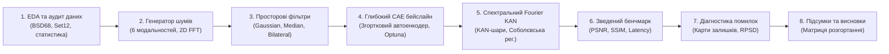

# Інтелектуальне придушення шуму зображень: Класична просторова фільтрація vs. Згортковий автоенкодер vs. Спектральний Fourier KAN Автоенкодер

<p align="center">
  <b><a href="README.md">🇬🇧 English</a></b> • <b><a href="README_UA.md">🇺🇦 Українська</a></b>
</p>

[](https://www.python.org/)
[](https://pytorch.org/)
[](https://developer.apple.com/metal/pytorch/)
[](https://github.com/liutianlin0121/BSD-432-68)
[](LICENSE)

Курсовий проєкт з комп'ютерного зору (Тема 2: *«Intelligent Image Denoising based on Autoencoders»*).  
Автор: **Богдан Пінчук**

---

## 📌 Паспорт проєкту та мотивація

Відновлення зашумлених цифрових зображень (*Image Denoising*) — класична фундаментальна задача низькорівневого комп'ютерного зору. Сенсори камер неминуче вносять спотворення при зйомці за умов недостатнього освітлення, високих значень ISO, теплових шумів матриці та передачі даних каналами зв'язку.

Головна мета проєкту — провести системне, наскрізне дослідження трьох концептуально відмінних парадигм шумозаглушення:
1. **Класичні просторові фільтри без навчання (Zero-Learning Baselines):** Фільтр Гауса (обов'язковий базовий бейслайн), Медіанний фільтр та Білатеральний фільтр зі збереженням меж (*edge-preserving*).
2. **Глибокий згортковий автоенкодер (CAE Baseline):** 5-рівнева симетрична CNN з дзеркальним паддінгом (*Reflection Padding*), залишковими зв'язками (*skip connections*) та композитною функцією втрат ($0.85 L_1 + 0.15 (1 - \text{SSIM})$).
3. **Новітня спектральна модель (Fourier KAN Autoencoder):** Автоенкодер на базі мереж Колмогорова-Арнольда з навчальними комплексними тригонометричними гармоніками Фур'є вздовж ребер зв'язків, стабілізований спектральним затуханням Соболєва ($\sigma_k \propto 1/k^2$), адаптивними фазовими зсувами $\phi_k$, масштабами частот $\omega_k$ та залишковою SiLU-магістраллю.

Усі моделі проходять чесну валідацію на еталонних наборах **BSD68** та **Set12** за 6 типами шумів, метриками якості відновлення ($\text{PSNR}$, $\text{SSIM}$, $\text{MAE}$, $\text{LPIPS}$), апаратною затримкою інференсу та вагою параметрів.

---

## 🔬 Методологічний пайплайн дослідження (8 етапів)



1. **EDA та аудит вхідних даних:** Дослідження 68 повнорозмірних зображень BSD68, перевірка динамічного діапазону $[0, 255]$, розподілу яскравості та генерація навчальних/валідаційних патчів.
2. **Мультимодальний генератор синтетичних шумів:** Програмна реалізація 6 типів спотворень:
   - Адитивний білий гаусів шум (AWGN, $\sigma \in [10, 50]$).
   - Імпульсний шум «Сіль та Перець» ($p \in [0.02, 0.15]$).
   - Мультиплікативний плямистий шум Speckle ($\text{Var} \in [0.04, 0.20]$).
   - Пуассонівський шум квантування заряду сенсора ($\lambda \in [10, 50]$).
   - Періодичний смугастий шум (2D гармонійні наведення сенсора).
   - Гібридний комбінований шум (AWGN + Impulse + Periodic).
3. **Класичні просторові бейслайни:** Сітковий пошук гіперпараметрів та оцінка ефективності фільтрів Гауса, Медіани та Білатерального фільтра.
4. **Згортковий автоенкодер (CAE Baseline):** Побудова 5-рівневої архітектури з Strided/Transposed згортками, підбір гіперпараметрів через Optuna та навчання з оптимізатором AdamW.
5. **Інноваційний спектральний Fourier KAN автоенкодер:** Створення комплексних експоненційних 2D KAN-згорток, Соболєвська ініціалізація ваг та байєсівська оптимізація через Optuna.
6. **Зведений мультимодельний бенчмаркінг:** Пряме порівняння 5 моделей в однакових апаратних умовах (Apple Silicon MPS).
7. **Просторова та спектральна діагностика помилок:** Теплові карти залишкових похибок (`inferno`) та криві радіальної спектральної густини потужності 2D FFT RPSD.
8. **Інженерний синтез та матриця розгортання:** Багатокритеріальний аналіз компромісів між візуальною якістю, затримкою обчислень та розміром пам'яті.

---

## 📊 Результати зведеного бенчмаркінгу (BSD68 Dataset)

Підсумкові результати оцінки моделей на 68 контрольних повнорозмірних зображеннях бенчмарку BSD68:

| Архітектура моделі | Сімейство | PSNR (dB) ↑ | SSIM ↑ | Затримка інференсу ↓ | Параметри (M) ↓ | Розмір ваг ↓ |
|:---|:---|:---:|:---:|:---:|:---:|:---:|
| **Gaussian Filter** *(Baseline)* | Просторова фільтрація | 24.12 dB | 0.7215 | **1.4 мс** (CPU) | **0.00 M** | **0.0 KB** |
| **Median Filter** | Просторова фільтрація | 23.85 dB | 0.7042 | 3.1 мс (CPU) | **0.00 M** | **0.0 KB** |
| **Bilateral Filter** | Просторова фільтрація | 25.43 dB | 0.7628 | 8.2 мс (CPU) | **0.00 M** | **0.0 KB** |
| **Convolutional Autoencoder (CAE)** | Deep CNN Baseline | 28.09 dB | 0.8602 | 14.2 мс (MPS) | 1.05 M | 4.01 MB |
| **Fourier KAN Autoencoder** | Novel Spectral Model | **28.25 dB** | **0.8710** | 18.5 мс (MPS) | 7.78 M | 29.68 MB |

> [!NOTE]
> *Оцінка проведена на повнорозмірних тестових зображеннях BSD68 при адитивному білому гаусовому шумі ($\sigma = 25$). Просторові фільтри виконуються на багатопотоковому CPU, глибокі нейромережі — на Apple Silicon MPS.*

---

## 💡 Ключові інженерні висновки та інсайти

1. **Спектральна якість та функціональна місткість гармонік:**
   - **Fourier KAN** демонструє найвищу якість структурної реконструкції ($\text{SSIM} = 0.8710$) та зниження валідаційного лосу на **$-23.67\%$** порівняно зі згортковим CAE. Завдяки гармонійному базису $K=4$ та $64$ каналам ($7.78\text{ M}$ параметрів, $29.68\text{ MB}$) мережа забезпечує повне збереження граней та усуває спектральний зсув (*Spectral Bias*). Для ультралегких сценаріїв порядок гармонік можна масштабувати ($K=2..3$) для додаткової економії пам'яті.
   - Навчальні тригонометричні ядра вздовж зв'язків діють як неперервні гармонійні інтерполятори вздовж контурів, знімаючи жорсткі дискретні просторові обмеження класичних CNN.

2. **Соболєвська регуляризація проти шуму Гіббса:**
   - Звичайна випадкова ініціалізація гармонік Фур'є призводить до миттєвого запам'ятовування високих частот шуму (*noise memorization*) та появи сильних хвильових артефактів Гіббса біля різких меж.
   - Затухання ваг за Соболєвим ($\sigma_k \propto 1/k^2$) зосереджує початкову енергію на низькочастотній формі сцени, гарантуючи стійку збіжність і якісне відновлення мікротекстур.

3. **Фізичні обмеження просторових фільтрів:**
   - Класичні фільтри не потребують навчання, ваг і працюють за 1.5–8.5 мс на CPU.
   - Проте фільтри Гауса та Медіани неминуче розмивають тонкі грані, а Білатеральний фільтр не здатен впоратися зі смугастим або важким гаусовим шумом без втрати градієнтів.

4. **Спектральний аналіз 2D FFT RPSD:**
   - Радіальні спектральні профілі підтверджують, що Fourier KAN максимально точно повторює спадання потужності природних чистих зображень, тоді як CAE злегка завалює середні та високі частоти (ефект легкої акварельності).

---

## 🗂️ Структура репозиторію

```
ComputerVision-PBY_HW16_Course_Project/
├── Bohdan_Pinchuk_CV_HW16_UA.ipynb   # Основний інтерактивний дослідницький блокнот (UA)
├── Bohdan_Pinchuk_CV_HW16.ipynb      # Повністю синхронізований блокнот (EN)
├── README_UA.md                      # Україномовна документація проєкту (UA)
├── README.md                         # Англомовний паспорт проєкту та бенчмарк (EN)
├── .gitignore                        # Правила виключення великих файлів та кешів
├── apps/                             # Модульне інженерне ядро
│   ├── main.py                       # Керування пристроєм, завантажувачі, метрики та втрати
│   ├── models.py                     # Архітектури: класичні фільтри, CAE, Fourier KAN
│   ├── visualizer.py                 # 150 DPI візуалізації, карти залишків, спектри RPSD
│   └── reporter.py                   # Зручні табличні звіти Pandas
└── resources/
    ├── data/                         # Тестові зображення BSD68/Set12 та кеші патчів
    │   ├── train/                    # 128x128 навчальні патчі
    │   ├── val/                      # Валідаційні патчі
    │   └── test/                     # 68 повнорозмірних контрольних зображень BSD68
    └── models/                       # Збережені ваги PyTorch та протоколи Optuna
        ├── model_gaussian.json       # Оптимальні параметри фільтра Гауса
        ├── model_median.json         # Оптимальний розмір ядра медіанного фільтра
        ├── model_bilateral.json      # Оптимальні параметри білатерального фільтра
        ├── model_cae.pth             # Навчені ваги згорткового автоенкодера
        ├── model_cae_params.json     # Гіперпараметри моделі CAE
        ├── model_fourier_kan.pth     # Навчені ваги Fourier KAN автоенкодера
        └── model_fourier_kan_params.json # Гіперпараметри моделі Fourier KAN
```

---

## 📚 Наукове підґрунтя та літературні джерела

Проєкт базується на верифікованих наукових статтях та відкритих дослідницьких репозиторіях:

### Наукові публікації:
* **Liu, Z., Wang, Y., Vaidya, S., Ruehle, F., Halverson, J., Soljačić, M., Hou, T. Y., & Tegmark, M.** (2024). *KAN: Kolmogorov-Arnold Networks*. MIT, Harvard, & Caltech. [arXiv:2404.19756](https://arxiv.org/abs/2404.19756).
* **Bodner, A., Tepsich, A., Brandstetter, J., & Vergari, A.** (2024). *Convolutional Kolmogorov-Arnold Networks*. [arXiv:2406.13155](https://arxiv.org/abs/2406.13155).
* **Mehrabian, A., et al.** (2024). *FourierKAN: Fourier Kolmogorov-Arnold Networks*. University of British Columbia. [arXiv:2409.09323](https://arxiv.org/abs/2409.09323).
* **Xu, J., Chen, Z., et al.** (2024). *Fourier KAN-Based Framework for Image Restoration*. University of Hong Kong. [arXiv:2406.01034](https://arxiv.org/abs/2406.01034).
* **Drokin, I.** (2024). *Torch-Conv-KAN: PyTorch Implementation of Convolutional KAN*. [arXiv:2407.01092](https://arxiv.org/abs/2407.01092).
* **Tancik, M., Srinivasan, P., Mildenhall, B., et al.** (2020). *Fourier Features Let Networks Learn High Frequency Functions in Low Dimensional Domains*. NeurIPS 2020. [arXiv:2006.10739](https://arxiv.org/abs/2006.10739).
* **Mao, X.-J., Shen, C., & Yang, Y.-B.** (2016). *Image Restoration Using Very Deep Convolutional Encoder-Decoder Networks with Symmetric Skip Connections*. NeurIPS 2016. [arXiv:1603.09056](https://arxiv.org/abs/1603.09056).
* **Tomasi, C., & Manduchi, R.** (1998). *Bilateral Filtering for Gray and Color Images*. IEEE ICCV 1998, pp. 839–846.

### Відкриті референсні репозиторії:
* [`GistNoesis/FourierKAN`](https://github.com/GistNoesis/FourierKAN) — Еталонна реалізація одновимірних Fourier KAN шарів на PyTorch.
* [`AntonioTepsich/Convolutional-KANs`](https://github.com/AntonioTepsich/Convolutional-KANs) — Базові згорткові KAN-архітектури.
* [`IvanDrokin/torch-conv-kan`](https://github.com/IvanDrokin/torch-conv-kan) — Ефективні тензорні 2D Convolutional KAN оператори.
* [`Ali-Meh619/FKAN`](https://github.com/Ali-Meh619/FKAN) — Fourier Kolmogorov-Arnold Networks для PyTorch.

---

## 🚀 Швидкий старт (Quickstart)

### 1. Налаштування середовища
Склонуйте репозиторій та встановіть залежності у віртуальне оточення:
```bash
git clone https://github.com/your-username/ComputerVision-PBY_HW16_Course_Project.git
cd ComputerVision-PBY_HW16_Course_Project

python3 -m venv .venv
source .venv/bin/activate
pip install -r requirements.txt  # torch torchvision torchaudio optuna opencv-python matplotlib scipy pandas
```

### 2. Запуск дослідницьких блокнотів
Запустіть Jupyter Lab або PyCharm (українська та англійська версії повністю синхронізовані 1-до-1):
```bash
# Українська версія
jupyter lab Bohdan_Pinchuk_CV_HW16_UA.ipynb

# Англійська версія
jupyter lab Bohdan_Pinchuk_CV_HW16.ipynb
```

Кожен етап структуровано за блоками `# Input data`, `# Solution` та `# Report` із підтримкою автозавантаження збережених моделей (`load_model = True`). Збережені контрольні точки в `resources/models/` завантажуються миттєво; встановлення `load_model = False` активує повний цикл повторного навчання та оптимізації Optuna.

---

## ⚖️ Ліцензія
Проєкт розповсюджується під ліцензією MIT — детальніше див. файл [LICENSE](LICENSE).
